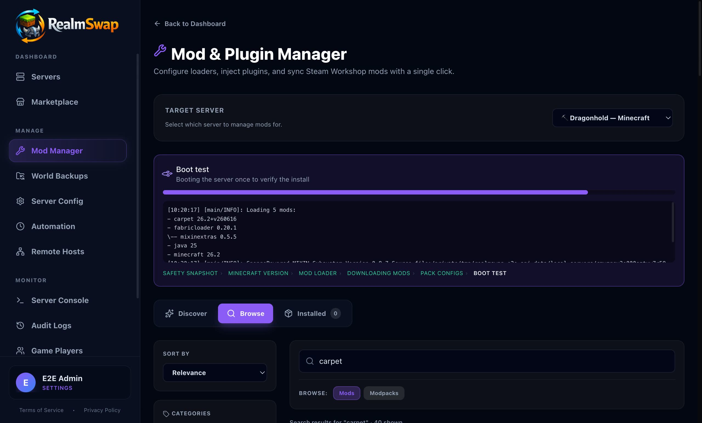

# RealmSwap 🎮

**The one app that gets a modded server for your friends running tonight — and the one link that fixes their client too.**

RealmSwap is a free, locally-hosted game server manager for your gaming PC or home machine. Pick a game, click deploy, and share one invite — your friends join, and the mods their client needs download themselves. No rent, no queues, no oversold nodes, and your world never locks behind a lapsed subscription.

**Mod installs are boot-tested before you see "success" — live today for Minecraft, Valheim, Project Zomboid, and Terraria, with more games on the way.** For those games, RealmSwap installs the modpack into a sandbox, actually boots the server, and only then calls it done — a bad mod, missing dependency, or wrong loader rolls the server back automatically instead of leaving you with a world that won't start.

<p align="center">
  <a href="docs/demo/realmswap-demo.mp4">
    
  </a>
  <br>
  <a href="docs/demo/realmswap-demo.mp4">▶ Watch the 2-minute demo</a> — deploy a server, watch the boot test verify the install, then invite friends with one link.
</p>

## Supported Games

One-click deployment out of the box:

- **Minecraft** (Vanilla, plus one-click **Fabric, Forge, NeoForge, and Quilt** loaders)
- **Valheim**
- **Enshrouded**
- **Project Zomboid**
- **ARK: Survival Evolved**
- **Terraria**
- **Palworld**
- **Rust**
- **Satisfactory**
- **V Rising**
- **Windrose**

*Custom games are supported via the JSON-based Game Definition Engine.*

## Key Features

### Mods that actually work
- **Verified installs**: every mod install, update, and modpack import runs snapshot → install → auto-rollback, with the **sandbox boot test** live for **Minecraft, Valheim, Project Zomboid, and Terraria** today (more games on the way). Broken installs fail loudly with the server's own boot output — never a silent "success" that doesn't load.
- **All the loaders**: Fabric, Forge, NeoForge, and Quilt install in one click (and modpacks pin the right one automatically).
- **CurseForge + Modrinth + Thunderstore + Steam Workshop**: search, one-click install with automatic dependency resolution, real versions, and per-mod updates. Modpack imports for `.mrpack` (Modrinth) and CurseForge manifests.
- **Client-mod handling**: client-only mods are detected and excluded from servers instead of crashing your boot, and problem jars are quarantined and retried for you.
- **First-try modpacks**: the target demo — a heavy pack like All the Mods 10 (499 mods), installed and booted, first try, in minutes.
- **Share custom games safely**: export any custom game definition as a `.realmswap-game.json` file, or publish a realm for a game RealmSwap doesn't ship. Shared definitions pass a strict gate — no scripts, nothing outside the server folder, downloads only from allowlisted hosts — and realms that bring their own game show you exactly what it downloads and runs before installing anything.

### Friends join in one click
- **RealmSync invites**: share a QR code or `realmsync://` link; the RealmSync companion app downloads every required mod and config to your friend's client and drops them into your server. The end of "does my friend need the modpack?"
- **Zero router setup**: an automated [playit.gg](https://playit.gg) tunnel works behind strict routers and CGNAT — no port forwarding, no dashboard wrangling. UPnP port-mapping (with automatic LAN fallback) is there too.
- **Your home IP stays private**: friends connect through the tunnel relay instead of your home's public address.
- **Can't-join troubleshooter**: one dialog diagnoses the whole path — server up, game listening, router, firewall — with copyable fixes.

### Built for game night
- **Discord game-night planning**: plan sessions, collect RSVPs, and the server **auto-starts before game night** (with a lead time you set) and can auto-stop when it's over.
- **Control from Discord**: start, stop, and monitor from your server's Discord bot.
- **The PC wakes up for game night**: a Windows wake timer goes off a few minutes before a scheduled start (automation or Discord session), and RealmSwap holds the machine awake while players are on — or when it can't tell — so a host nobody is typing on doesn't fall asleep under its friends. Toggle both in Settings → Dedicated Box.
- **Crash recovery with one-tap restart**: crashes are detected and auto-retried, and you get a push/email/Discord alert with a **Restart Server** button right in the notification.
- **Reachability alerts**: if a running server's public path breaks — a tunnel playit stopped forwarding, a router that rebooted and dropped its UPnP mapping — you get a push/email/Discord alert before your friends hit a connection timeout, and another when it's back.
- **Idle auto-stop**: nobody online? RealmSwap can shut the server down (and your power bill with it) after a quiet window you choose.

### Your data stays yours
- **Verified backups**: every snapshot is verified on creation (the archive is opened and entries decompressed) and badged ✓ Verified / ⚠ Failed. Save state is flushed before backup on games that support it.
- **Offsite S3 backups**: point RealmSwap at any S3-compatible bucket for encrypted offsite copies — and restore from the cloud even if the local file is gone.
- **RealmSwap Vault**: done with a game? Archive the whole server (worlds, configs, mods) to your hard drive and restore it instantly months later. Switch games without losing a block.
- **Shareable status pages**: generate a no-login link showing whether the server is up, who's online, and the next planned session — perfect for pinning in Discord. A hosted copy at `realmswap.app/s/<code>` keeps answering even when your PC is off.

### A real dashboard, not an admin console
- **Live console**: read live logs with level colors and filtering, send commands, and browse archived logs.
- **Typed game settings**: max players, difficulty, MOTD, and more through friendly forms — saved settings re-render config files and launch arguments automatically. Raw `.ini`/`.json`/`.properties` editing is there when you want it, with your hand edits preserved.
- **Real-time monitoring**: CPU, RAM, disk usage, live player counts, and a 7-day busiest-hours heatmap.
- **Automation**: scheduled backups, restarts, updates, and custom commands on a real cron engine.
- **Cloud Advisor & migration tools**: moving to a rented box? Get provider recommendations and push your local save data over with the built-in SFTP client.
- **Community marketplace**: discover and install community-made configurations, modpacks, and server templates.
- **Remote Hosts**: register a second machine — the old laptop, the basement box — as an agent node (HMAC-authenticated enrollment) and run servers on it from the same dashboard: start/stop, mods, worlds, and backups, all from your main screen.

## Getting Started

### Install (Windows)
1. Download `RealmSwap-Setup.exe` from the [latest release](https://github.com/RealmSwap/RealmSwap/releases/latest).
2. Run the installer and create your account — the first account on a fresh install is the admin.
3. Pick a game, hit deploy, and open **Join Info** to invite your friends.

> Windows SmartScreen may show "Windows protected your PC" on first run —
> choose **More info → Run anyway** (the app is currently unsigned; its
> publisher reputation builds with installs). Every release publishes
> `SHA256SUMS.txt` so you can verify your download:
> `Get-FileHash .\RealmSwap-Setup.exe -Algorithm SHA256`.

> RealmSwap hosts on your own machine. The packaged installer targets **Windows** today (that's where the target audience's gaming PCs are); running the web app from source works anywhere Node runs, and a Docker runner for Linux container hosts is built in.

### From source (development)
Prerequisites: [Node.js 22+](https://nodejs.org/) and [Git](https://git-scm.com/).

```bash
git clone https://github.com/RealmSwap/RealmSwap.git
cd RealmSwap
npm install
npm run db:push
npm run dev            # web app on http://localhost:3000
# or
npm run electron:dev   # desktop app
```

## Technology & Architecture

- **Frontend**: Next.js 16 (App Router), React 19, Tailwind CSS, Lucide Icons
- **Backend**: Next.js API routes, Node.js (`child_process`), Prisma ORM
- **Desktop wrapper**: Electron with an embedded standalone Node server (auto-updating)
- **Database**: SQLite via Prisma — local file-based, zero configuration
- **Runner abstraction**: server execution sits behind a `ServerRunner` interface — `LocalRunner` for native execution, `RemoteRunner` for agent nodes (Remote Hosts), `DockerRunner` for containerized hosts
- **Mods engine**: provider abstraction (Modrinth / CurseForge / Thunderstore / Steam Workshop), dependency BFS resolution, jar-manifest loader detection, sandbox boot testing with bundled JDK
- **RealmSync engine**: HTTP invite server serving a signed, HMAC-authenticated manifest + config bundle to joining players
- **Connectivity**: automated playit.gg agent management (claim → tunnel → live address), zero-dependency UPnP client with lease renewal, LAN fallback
- **Verification ladder**: `npm run verify` — typecheck, ~1,500 unit tests, an API e2e harness that exercises every route (including real Minecraft server boots), Electron GUI e2e, and a Playwright suite over the public surface. A nightly matrix adds the heavy scenarios and a Windows release smoke that installs real released artifacts and proves the auto-update path end to end.

## Roadmap & Contributing

Contributions are welcome — branch off `main` and open a pull request. Currently on the roadmap:

- **Dedicated-box mode** — finish the "old laptop in the closet" story: no-login service mode for spare hardware (launch-at-login, wake timers, Discord start/stop, and idle auto-stop already shipped)
- **Wake-on-LAN for remote hosts** — the same wake-before-game-night treatment for agent nodes, which currently need to be awake to accept a start
- **Community game-definition marketplace listings** — first-class browse/review for shared game definitions (the safety gate, consent step, and file sharing already shipped)
- **Windows code signing** — the build pipeline signs automatically once an Azure Artifact Signing account or certificate is configured (see `docs/code-signing.md`; releases already publish SHA256 checksums)
- **Docker container abstractions** for true cross-platform hosting
- More game definitions — the least-served games first
